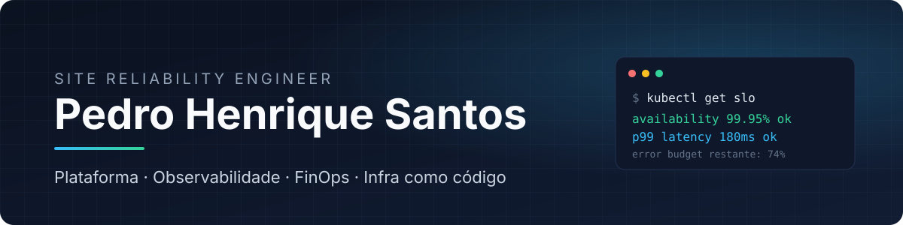

  

  
  
  

 

Engenheiro de confiabilidade que também constrói produto. Cuido para que plataformas fiquem de pé, rápidas e baratas de operar, e escrevo o software que roda nelas: do Terraform ao frontend, passando pela observabilidade e pelo pipeline.

Hoje desenvolvo sistemas para **cidades inteligentes e gestão pública**, além de produtos SaaS próprios do zero à produção.

## No que trabalho

<table>
<tr>
<td width="50%" valign="top">

**FinOps multi-cloud** 
Coleta de custo e utilização em AWS e Azure, recomendações de economia e relatórios para quem paga a conta.

</td>
<td width="50%" valign="top">

**Observabilidade** 
Datadog, OpenTelemetry e Prometheus: traces, métricas, RUM, SLOs e alertas que alguém consegue agir.

</td>
</tr>
<tr>
<td valign="top">

**Infraestrutura como código** 
Módulos Terraform por ambiente, Ansible, Helm e Bicep. Nada criado à mão que não possa ser recriado.

</td>
<td valign="top">

**Plataforma e entrega** 
Kubernetes, Docker e pipelines no GitHub Actions e Jenkins com deploy em ECS e EC2, teste de carga e rollback.

</td>
</tr>
<tr>
<td valign="top">

**Backend** 
Serviços em Go e Python com PostgreSQL, Redis, Kafka e gRPC, desenhados para concorrência e falha.

</td>
<td valign="top">

**Produto full-stack e IA** 
SaaS com React, Next.js e Flutter, e um harness de engenharia com múltiplos agentes de IA.

</td>
</tr>
</table>

## Stack

<table>
  <tr><td><b>Linguagens</b></td><td></td></tr>
  <tr><td><b>Cloud e IaC</b></td><td></td></tr>
  <tr><td><b>Plataforma</b></td><td></td></tr>
  <tr><td><b>Observabilidade</b></td><td>   </td></tr>
  <tr><td><b>Dados e mensageria</b></td><td></td></tr>
  <tr><td><b>Frontend e mobile</b></td><td></td></tr>
</table>

## Projetos abertos

| Projeto | O que é | Stack |
|---|---|---|
| [querofitness-store](https://github.com/SRE-Pedro/querofitness-store) | Loja virtual standalone da QueroFitness | Next.js, TypeScript, Docker |
| [CI-CD_rollback](https://github.com/SRE-Pedro/CI-CD_rollback) | API em Go com pipelines de deploy em EC2 e ECS e teste de carga | Go, Docker, GitHub Actions, AWS |
| [monorepo-microservico-kafka](https://github.com/SRE-Pedro/monorepo-microservico-kafka) | E-commerce em microsserviços comunicando por eventos | Java, Kafka, Maven |
| [go-Kafka](https://github.com/SRE-Pedro/go-Kafka) | Consumidor de mensagens Kafka em Go | Go, Sarama |
| [K8s](https://github.com/SRE-Pedro/K8s) | Aplicação e banco orquestrados manualmente no Kubernetes | Kubernetes |
| [IaC-terraform-Docker_aws](https://github.com/SRE-Pedro/IaC-terraform-Docker_aws) | Provisionamento de bucket S3 e serviço Docker na AWS | Terraform, AWS |
| [Web-Golang](https://github.com/SRE-Pedro/Web-Golang) | Aplicação web MVC com PostgreSQL | Go, PostgreSQL |
| [Monitoramento_Golang](https://github.com/SRE-Pedro/Monitoramento_Golang) | Monitor de disponibilidade de sites com log de status | Go |

 

  <picture>
    <source media="(prefers-color-scheme: dark)" srcset="https://raw.githubusercontent.com/SRE-Pedro/SRE-Pedro/output/github-snake-dark.svg">
    
  </picture>

Aberto a conversas sobre SRE, plataforma, FinOps e produtos de software.

